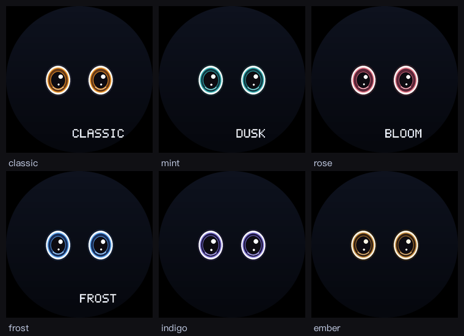
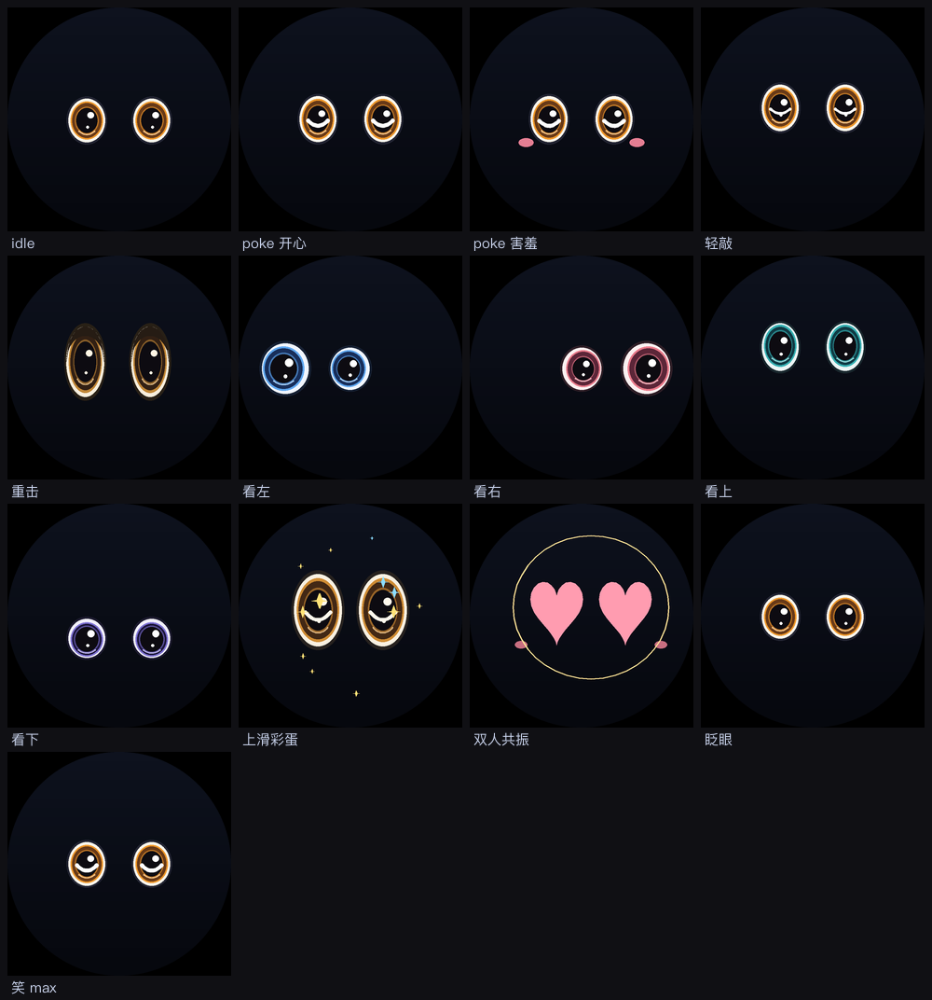

# Duetto — 桌面听歌搭子的表情原型

把听歌时的敲击与手势，变成桌面上一个有反应的活物。

硬件还没打样，先用 Python 把交互调好；**代码按「可原样搬进 Arduino」的方式组织**，并且已经带了单机测双人的联调工具。

---

## 30 秒上手

```bash
python3 duetto_duo.py --mode split     # ★ 双人联调（左右各一台）
python3 eyes_sim.py --showcase         # 单台眼睛原型（启动即轮播全部设计）
```

> 需要 Python 3.8+ 与 Tkinter（macOS 自带；Linux 装 `python3-tk`）。
> 无窗口环境想看效果：`python3 render_frames.py`（依赖 Pillow）。

## 按键（双人模式）

| | 轻敲 | 重击 | 9 宫格 |
|---|---|---|---|
| **左屏（我）** | `F` | `空格` | `QWE` / `ASD` / `ZXC` |
| **右屏（对方）** | `K` | `回车` | `UIO` / `JKL` / `M,.` |

**两只手先后各敲一下（相差 0.3s 内）→ 中间触发共振，两屏同时变成心形。**

单机版的 9 宫格换成真实键盘布局 `T Y U / G H J / B N M`。

单机版还多了几个不接硬件也能玩的：

| 操作 | 效果 |
|---|---|
| 鼠标在画面上移动 | 眼睛跟着你转（只转瞳孔，不整只眼睛平移） |
| 点一下画面 | 被摸头 → 弯眼笑 |
| `Shift` + 点 | 害羞 → 脸红 + 视线往斜下躲 |
| `Tab` | 轮播全部眼睛设计 |

---

## 眼睛设计

参考 GROOVE X 公开的设计访谈：LOVOT 的眼睛是「虹膜、瞳孔、眼皮在内共 6 层」
叠出来的，靠**层与层之间的明度差**造出"被吸进去"的深度感，而不是靠画得细。

这里用同一套思路，裁到圆屏跑得动的 9 层：

```
眼白 glow → 眼白本体 → 虹膜外圈 → 虹膜内圈 → 内亮边
→ 瞳孔 → 下缘月光 → 主高光 → 次高光
```

关键取舍：**不画「白眼球 + 黑瞳孔」的强对比**。Cozmo / Vector 这类屏幕表情
都是单色实心块，因为小圆屏上一画白眼球就像个摄像头。

六套设计，各有自己的色系和形状个性：

| key | 名字 | 气质 | 用在哪 |
|---|---|---|---|
| `classic` | 暖金 | 最上镜的主形象 | 默认 / 轻敲 |
| `mint` | 青碧 | 安静、低饱和 | 往上看 |
| `rose` | 樱粉 | 手绘水彩，最可爱 | 往右看 / 共振 |
| `frost` | 霜蓝 | 偏冷偏亮 | 往左看 |
| `indigo` | 靛紫 | 瞳孔最大，专注 | 往下看 / 害羞 |
| `ember` | 暗金 | 主高光很弱，靠虹膜跑马灯 | 重击 / 上滑彩蛋 |



设计切换是**逐字段插值**的（颜色线性插值 + `EyeDesign.blend_design`），
切到一半不会闪一下。

### 表情与"活着"的感觉

情绪用一根轴表达，不是状态枚举：`mood` 0=困、0.5=平静、1=兴奋。
敲击 / 上滑 / 共振都只是往这根轴上打一脚，然后自己缓慢落回去。

另外三个独立通道：`joy`（弯眼笑）、`surprise`（瞪大、瞳孔缩小）、
`blush`（脸红 + 视线躲开）。

还有一件不那么显眼但影响最大的事：**视线游走（saccade）**。
每 0.5~1.7 秒换一个随机注视点，带惯性弹簧跟过去。
没有这个，眼睛就是"盯着一个点发愣"的死亡凝视 ——
这个不是感觉，是实测：改之前待机画面连续 90 帧像素完全一致。



---

## 一台电脑怎么测双人效果

`EyeStateMachine` 是纯状态对象，没有任何全局状态。所以 **new 两个实例就是两个"人"**：

```python
sm_a = EyeStateMachine()   # 我
sm_b = EyeStateMachine()   # 对方
```

三种模式：

| 模式 | 命令 | 用途 |
|---|---|---|
| `split` | `duetto_duo.py --mode split` | 左手/右手各管一台，最接近真实双人 |
| `ai` | `duetto_duo.py --mode ai --synergy 0.65` | 只操作 A，B 按概率自动跟随（路演单人用） |
| 回放 | `duo_bridge.py --replay take1.json` | 用固定输入重跑，排除"人的手速"这个变量 |

**这能让你在硬件到位前就调完三件事**：共振判定参数、心形彩蛋的视觉方向、灯带的合并逻辑。

### 共振判定

`duetto_duo.ResonanceJudge` / `duo_bridge.Bridge` 用同一套逻辑：**窗口内两边都出现"激烈情绪"（轻敲/重击/上滑）→ 触发**。

```bash
duo_bridge.py --window 0.8    # 默认 1.5，实测偏宽松，建议 0.8 起步
```

> 跑 16 秒模拟，1.5s 窗口触发 3 次、其中一次两边差了 0.37s；收到 0.8s 只触发 2 次，质量更高。真实双人不会差 1.5 秒还算同频。

---

## 双机迁移指南（给 agent 的执行手册）

> 目标：把当前的单机双人联调，换成 **两台硬件 + 一根 USB 线 + 一个 Python 中枢**。
> 架构来自《Duetto Demo 制作说明》1.1：避开无线配网，两台设备各占一个串口，PC 做桥接。

### Step 0 · 先跑通无硬件链路

**在做任何硬件改动前**，确认 PC 侧逻辑是好的：

```bash
python3 duo_bridge.py --simulate --record --out take1.json
python3 duo_bridge.py --replay take1.json
```

期望：终端打印 `★ 共鸣触发！`，结束后生成 `take1.json`，里面有带毫秒时间戳的事件。
**这一步失败就不要往下走**——问题在 PC 侧，不在硬件。

### Step 1 · 串口协议（两边必须一致）

波特率 **115200**，行尾 `\n`。

| 方向 | 内容 | 何时发 |
|---|---|---|
| 硬件 → PC | `I`（待机）/ `T`（敲击）/ `L`（左滑）/ `R`（右滑）/ `U`（上滑爆发） | 状态**变化时**发一次，或每 100ms 发一次 |
| PC → 硬件 | `S1` | 进入共振 |
| PC → 硬件 | `S0` | 退出共振 |
| PC → 硬件 | `P_X`（X 是对方状态字符） | 每轮状态更新时，用于点亮灯带另一半 |

### Step 2 · 设备端要做的最小改动

**固件侧只需两件事**（其余动画逻辑完全复用现有 `eyes_core` 的移植版）：

1. **上报状态**：把手势识别结果写成一个字符丢进串口。
   ```cpp
   void reportState(char s) {
     if (s == lastReported) return;      // 只在变化时发，省带宽
     lastReported = s;
     Serial.print(s); Serial.print('\n');
   }
   // 敲击时 reportState('T'); 上滑时 reportState('U'); 松手回中 reportState('I');
   ```

2. **接收指令**：非阻塞地读串口，遇到 `S1` 就触发共振通道。
   ```cpp
   void pollSerial() {
     if (!Serial.available()) return;
     static String buf;
     while (Serial.available()) {
       char c = Serial.read();
       if (c == '\n') {
         if (buf == "S1") sm.triggerBond(+1);   // 邻机在右就传 +1
         else if (buf == "S0") { /* 让 bond 自然衰减即可 */ }
         else if (buf.startsWith("P_")) { remoteState = buf.charAt(2); }
         buf = "";
       } else if (c != '\r') buf += c;
     }
   }
   ```

   **关键：不能阻塞**。`pollSerial()` 放在主循环里每圈调一次，别用 `while(!Serial.available())`。

### Step 3 · 把 `bond` 通道移植到 Arduino

Python 侧的共振状态在 `eyes_core.py` 的 `EyeStateMachine` 里，是三个字段：

| 字段 | 含义 |
|---|---|
| `bond` | 0..1 强度 |
| `bond_t` | 已持续时长 |
| `bond_side` | -1 邻机在左 / +1 邻机在右 / 0 居中 |
| `bond_len` | 总时长（默认 3.5s） |

对应 Arduino 实现（加到你的状态结构体里）：

```cpp
struct { float bond = 0, bondT = 0; int bondSide = 0; const float BOND_LEN = 3.5f; } bondState;

void triggerBond(int side) { bondState.bond = 1.0f; bondState.bondT = 0; bondState.bondSide = side; }

// 在 updateState(dt) 里
if (bondState.bond > 0) {
  bondState.bondT += dt;
  if (bondState.bondT >= bondState.BOND_LEN) { bondState.bond = 0; bondState.bondSide = 0; }
}
```

**渲染侧**（比 Python 简单，因为不需要平滑插值）：

```cpp
// 共振时直接画心形，跳过瞳孔
if (bondEnv > 0.03f) {
  drawHeart(ecx, ecy, erx * 1.0f, ery * 1.05f);   // 心形填充
  continue;
}
```

心形用极坐标曲线采样填多边形，或（更省事）用两个圆 + 一个旋转 45° 的方块拼：

```cpp
void drawHeart(int cx, int cy, int r) {
  spr.fillCircle(cx - r/2, cy - r/3, r*0.62, C_HEART);   // 左瓣
  spr.fillCircle(cx + r/2, cy - r/3, r*0.62, C_HEART);   // 右瓣
  // 下半部用三角形收尖
  spr.fillTriangle(cx - r*1.06, cy, cx + r*1.06, cy, cx, cy + r*1.25, C_HEART);
}
```

### Step 4 · 接线要点（来自《制作说明》第二节）

副机（ESP32）推荐分配：

| 外设 | 引脚 |
|---|---|
| MPU6050 + MPR121（I2C 并联） | SDA=21, SCL=22，`Wire.setClock(400000)` |
| 灯带 DIN | GPIO25 |
| 舵机 PWM | GPIO26（避开 SPI 的 18） |

> 供电红线：**舵机和灯带接 5V/VIN，绝不接 3.3V**，否则舵机一转屏幕就黑屏重启。所有 GND 共地。

### Step 5 · 验收

- [ ] `--simulate` 能触发共鸣（无硬件）
- [ ] 单机插上后，串口能收到 `I/T/L/R/U`
- [ ] 两台同时插上，PC 能分别识别两个端口（`duo_bridge.py --list`）
- [ ] 两人同时敲击 → 两台屏幕同时变心形 + 灯带合并（`S1`）
- [ ] 只动一台 → 另一台灯带的**另一半**显示对方颜色（`P_X`）

---

## 代码结构

```
eyes_core.py        动画状态机（纯标准库，零绘图依赖）
  ├── tap(kind)              轻敲 / 重击
  ├── press_grid(key)        9 宫格
  ├── trigger_hype()         上滑彩蛋
  ├── trigger_bond(side)     ★ 双人共振
  ├── update(dt)             推进时间
  └── build_frame()          产出绘制指令

eyes_render.py      绘制指令 → Tkinter / Pillow（= Arduino GFX 对照表）
eyes_sim.py         单台模拟器

duetto_duo.py       ★ 一台电脑模拟两台设备
duo_bridge.py       ★ 双机串口中枢（含 --simulate 无硬件模式）
render_frames.py    无头预览，导出 GIF

arduino/eyes_arduino/   Arduino 移植（含迁移对照表）
archive/owl/            早期小猫头鹰形象，已存档，可独立运行
docs/                   调研与设计文档
```

### 三层架构的意义

```
输入（键盘 / 按钮 / 触摸焊盘）
   ↓
eyes_core.EyeStateMachine     只有浮点数，update(dt) + build_frame()
   ↓  DrawList
eyes_render                    Tkinter | Pillow | Arduino GFX
```

`eyes_core.py` **一个绘图库都不 import**，时间由外部 `update(dt)` 喂进来。所以同一份状态机可以原样跑在 Python 和 C++ 上。

坐标全部归一化到 **-1..1**（原点屏幕中心，y 向下，半径 1 = 屏幕半径），换 128/240/454 分辨率只改 `SCREEN` 常量。

---

## 绘制指令清单（移植时照这个写）

`build_frame()` 返回的 `DrawList` 里只有这些图元：

| 图元 | 内容 | Tkinter / GFX 对应 |
|---|---|---|
| `Ellipse` | 眼白，(cx, cy, rx, ry) | `create_oval` / `fillEllipse` |
| `('pupil', cx, cy, rx, ry)` | 瞳孔 | `fillEllipse` |
| `('glint', cx, cy, rx, ry)` | 高光点 | `fillCircle` |
| `('lid', pts)` | 眼皮多边形 | `create_polygon` / 逐列 `fillRect` |
| `('spark', cx, cy, size, ang, phase)` | 彩蛋星星 | 小四角星 / `fillCircle` |
| `('bond_heart', pts)` | ★ 共振心形 | `fillPoly` 或 两圆 + 三角 |
| `('bond_ring', pts, alpha)` | ★ 共振光环 | 描边多边形 / 空心圆 |

时间参数（已按调研建议校准，无需再调）：

| 动作 | 时长 | 备注 |
|---|---|---|
| 眨眼 | 160ms | 随机 2.4–6.5s 一次 |
| 轻敲 | 380ms | 下沉 0.26，回弹 42% |
| 重击 | 800ms | 下沉 0.40，回弹 75% + 左右晃 |
| 上滑彩蛋 | 2.6s | 星星爆发 |
| **共振** | **3.5s** | 心形 + 光环 + 灯带合并 |

---

## 调参速查

| 位置 | 作用 |
|---|---|
| `eyes_core.py` 的 `LIGHT_TAP` / `HEAVY_TAP` | 敲击力度、时长、回弹 |
| `eyes_core.py` 的 `SwipeDetector.window` | 上滑判定窗口（1.0s） |
| `EyeStateMachine.bond_len` | 共振持续时长 |
| `duetto_duo.ResonanceJudge(window=...)` | 共振判定窗口 |
| `duetto_duo.light_for()` | 灯带左右分区颜色 |
| `eyes_render.BOND_RING` / `HEART` | 共振光环 / 心形颜色 |

---

## 已知限制

- **ESP32 核心的编译验证尚未完成**（见下）。`arduino/eyes_arduino/` 里是几何版移植，逻辑与 Python 一致但未实测。
- **帧率硬约束**：Adafruit 用同一块 GC9A01A 实测，ESP32-S3 画**双眼约 20 FPS**（单眼 39 FPS）。按 20 FPS 设计。
- **共振的双向灯带只在 PC 侧模拟**。真机上「对方状态画到自己灯带另一半」需要固件实现 `P_X` 解析，见 Step 2。
